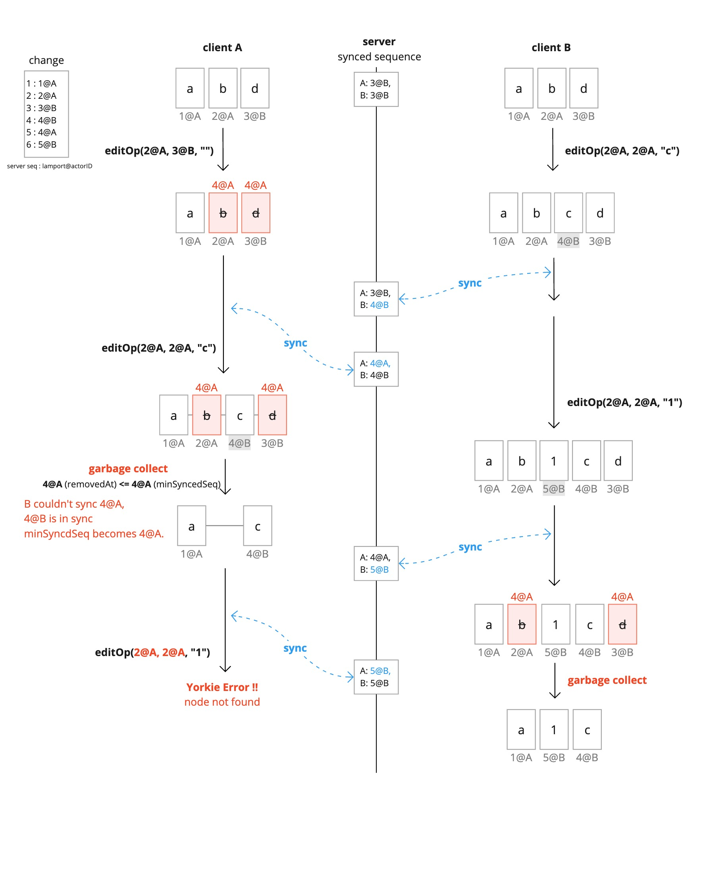
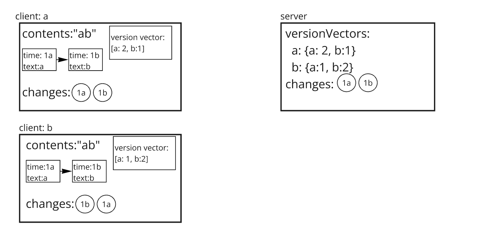
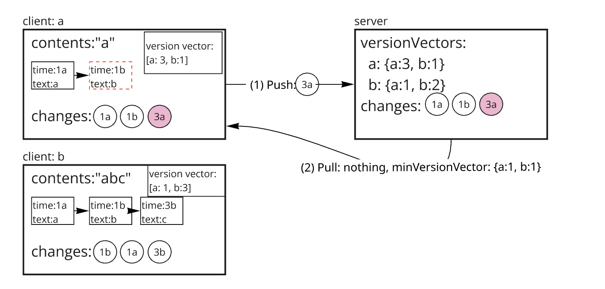
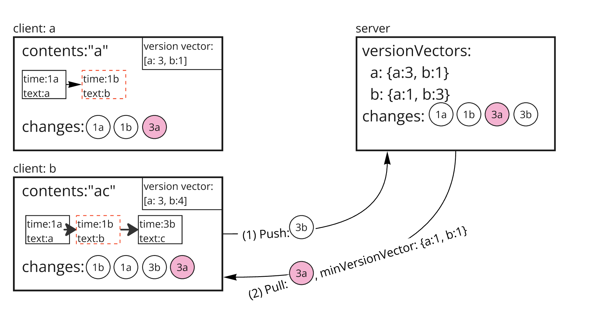
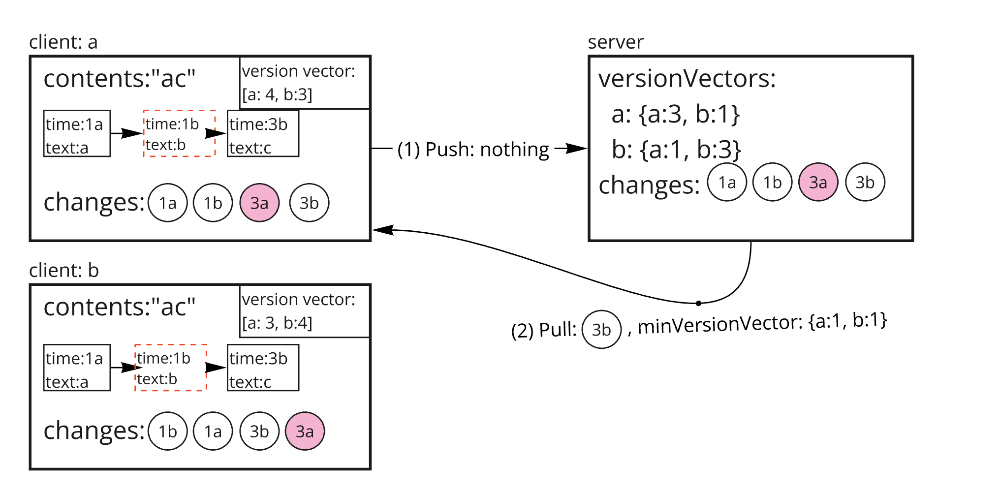
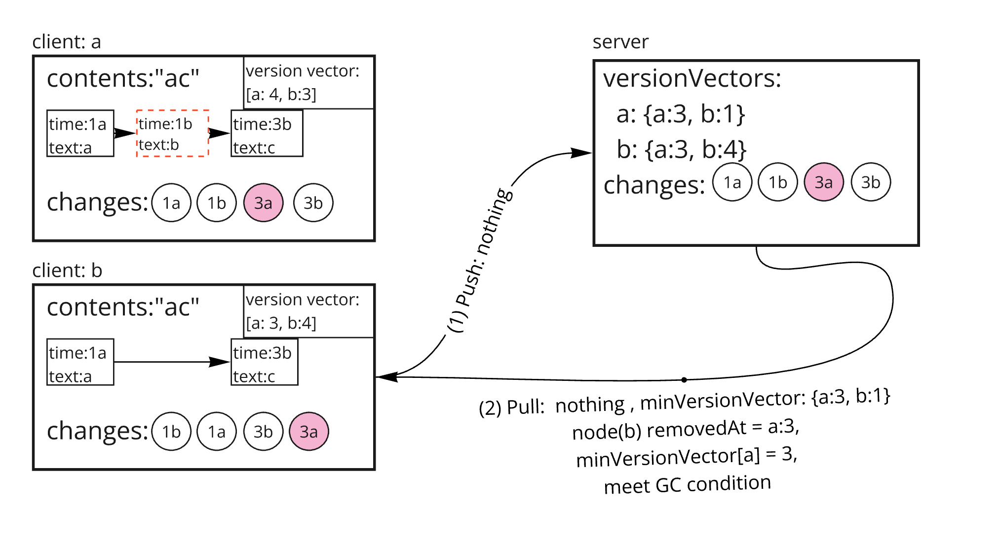
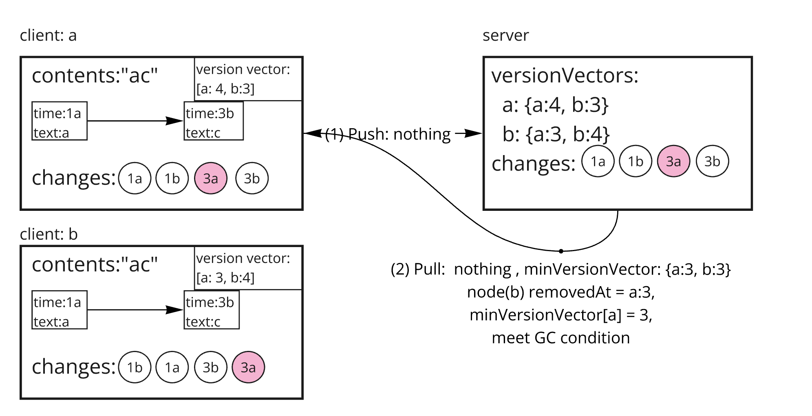

# Garbage Collection

## Before watch this document

In this document, the term referred to as `version vector` will be used throughout for explanatory purpose.
You'd better read [this](https://github.com/yorkie-team/yorkie/pull/981) first to understand concepts and usage of version vector.

## Summary

One of the most important issues in CRDT systems is handling tombstones. Tombstones are used to properly synchronize the document even when remote peer's operations refer to the elements that have already been locally deleted. This causes the problem that the document keeps growing even if elements are deleted.

Yorkie provides garbage collection to solve this problem.

### Goals

Implements garbage collection system that purges unused nodes not being referenced remotely.

### Non-Goals

For text types, garbage collection works slightly differently: refer to [this document](gc-for-text-type.md).

## Proposal Details

### Why We Need Version Vector rather than only use Lamport

Previously we used Lamport (`min_synced_seq`) to handle `Garbage Collection`. It was simple and lightweight to use, but it has crucial weakness that Lamport doesn't guarantee causality.


As you can see from the image above, `min_synced_seq` doesn't guarantee every client receives change.

### How It Works

Garbage collection checks that deleted nodes are no longer referenced remotely and purges them completely.

Server records the version vector of the last change pulled by the client whenever the client requests PushPull. And Server returns the min version vector, `minVersionVector` of all clients in response PushPull to the client. `minVersionVector` is used to check whether deleted nodes are no longer to be referenced remotely or not. A client may collect with it only after applying every change the server held when the vector was taken, which is why the server does not attach it to a push-only reply at all (see below).

## What is `minVersionVector`

Min version vector is the vector which consists of minimum value of every version vector stored in version vector table in database.

Conceptually, min version vector is version vector that is uniformly applied to all users. It ensures that all users have at least this version applied. Which means that it is safe to perform GC, for a replica that has itself pulled every change up to the server's head.

```
// GC algorithm

if (removedAt.lamport <= minVersionVector[removedAt.actor]) {
    runGC()
}
```

```
// how to find min version vector

min(vv1, vv2) =>
for (key in vv1 || key in vv2) {
    minVV[key] = min(vv1[key] || 0, vv2[key] || 0)
}

ex)
min([c1:2, c2:3, c3:4], [c1:3, c2:1, c3:5, c4:3])
=> [c1:2, c2:1, c3:4, c4:0]

```

## GC Responsibility by Response Type

GC responsibility is split between server and client depending on the response type:

- **Snapshot response**: The server runs GC with `minVersionVector` before serializing the snapshot. The client receives a clean state and skips GC (`!pack.hasSnapshot()` guard in the SDK).
- **Changes response**: The server sends `minVersionVector` in the response pack. The client runs GC locally using this vector after applying the changes.
- **Push-only response**: The server sends no `minVersionVector`, and the client takes the reply as a push ack only (confirmed local changes, client seq, removal flag) and skips GC. The vector can already cover a removal whose concurrent remote changes this client has not pulled; collecting the tombstone they anchor on would leave the next full pull unable to apply them (`node not found`), on every retry, since the server redelivers the same pack. The next full pull applies those changes first and then collects with that pull reply's `minVersionVector`. The server still records the pushing client's own vector into the minimum, so omitting it from the reply keeps no tombstone alive that was not already needed. SDKs also drop the vector on their own push-only path (yorkie-js-sdk#1393, #2096); that guard stays useful against servers older than this change.

This means the server must always GC the document before building a snapshot response. Without this, tombstones from applied changes would leak into the snapshot and persist on the client, since the client does not run GC for snapshot responses by design.

## Which ticket a tombstone carries

The algorithm above reads `removedAt`, so choosing the ticket a node is tombstoned with chooses when it may be purged. For a plain delete the choice is forced: the delete's own ticket. Two cases in `Tree` are not plain deletes, and both stamp the ticket of the REMOVAL that logically swept the node, not the ticket of the operation that happened to create it:

- **Born tombstoned** — content inserted into a parent that a concurrent change already removed here (`pkg/document/crdt/tree.go`, the `fromParent.IsRemoved()` branch of `Edit`).
- **Recreated under a purged parent** — an identity-preserving restore that has to rebuild a node whose parent is a tombstone (`recreateFromSpan`).

Stamping the inserter's own ticket is what caused #2327. That ticket is covered by `minVersionVector` as soon as the insert reaches the server — but the inserter has not pulled the removal yet, and keeps anchoring its next keystrokes to the node it believes is live. The receiving replica purged it and then could not apply the inserter's next change (`node not found`), on every redelivery, which wedges the pair.

The parent's `removedAt` is the ticket no minimum vector covers until every replica, the inserter included, has pulled the removal. It is also what the inserter's own replica waits on: there the node is never tombstoned at all (the removal did not see its creation, so `canDelete` declines), so it goes only when the parent subtree is purged. Stamping it makes both replicas purge the node on the same vector.

The stamp only has to be overwritable by the eventual LWW winner, and it is: a later concurrent removal with a higher ticket reaches the tombstoned node and overwrites it.

### What else reads the stamp

`removedAt` is not read by GC alone. Two readers in `Tree`'s delete walk ask "did the editor already see this node gone?" and answer it from the same ticket:

- `tombstoneKnown` in `collectBetween`, which feeds `canDelete` and so decides whether this delete overwrites the existing tombstone;
- `seenGone` in `appendUnknownSplitSiblings`, which decides whether the split-sibling cascade walks past the node or stops there — a deletion-set decision, not a timing one.

For the two non-plain-delete cases above, both now answer by the parent's removal rather than by the insert. That is the answer that matches what a replica sees — a replica that does not know the parent removal has the node live, so an editor that does not know it has not "seen it gone" — and it also removes a Go-internal disagreement: under the old stamp the inserter's own replica (tombstone absent, `seenGone` false) and every other replica (tombstone present, `seenGone` true) always disagreed, while under the parent's ticket they agree whenever the editor does not know the removal.

A born tombstone is consequently the one node whose `removedAt` precedes its own `createdAt`; code that assumes the two are ordered must not be pointed at it.

The yorkie-js-sdk still stamps the inserter's ticket in its equivalent branch. Until it carries the same stamp, a Go replica and a JS replica can resolve those two reads differently for the same born tombstone and so compute different deletion sets. Changing the stamp there is the follow-up that closes this; the two SDKs agree today only on nodes whose tombstone is a plain delete.

## An example of garbage collection:

### State 1



In the initial state, both clients have `"ab"`.

### State 2



`Client a` deletes `"b"`, which is recorded as a change with versionVector `{b:1}`. The text node of `"b"` can be referenced by remote, so it is only marked as tombstone. And the `Client a` sends change `3a` to server through PushPull API and receives as a response that `minVersionVector` is `{a:1, b:1}`. Since all clients did not receive the deletion `change 3a`, the text node is not purged by garbage collection.

Meanwhile, `client b` inserts `"c"` after textnode `"b"` and it has not been sent (pushpull) to server yet.

### State 3



`Client b` pushes change `3b` to server and receives as a response that `minVersionVector` is `{a:1, b:1}`. After the client applies change `3a`, the contents of document are changed to `ac`. This time, all clients have received change `3a`. Since node "b" is removed at `3a`, it's still marked as tombstone for every clients, because `minVersionVector[a] = 1 < 3`

### State 4



`Client a` pulls change `3b` from Server. `minVersionVector` is still `{a:1, b:1}`, so no GC happens.

### State 5



`Client b` pushpull but nothing to push or pull. `minVersionVector` is now `{a:3, b:1}`, node "b" removedAt is `3@a`, and `minVersionVector[a] = 3 >= 3`, thus `client b` meets GC condition

### State 6



`Client a` pushpull but nothing to push or pull. `minVersionVector` is now `{a:3, b:3}`, node "b" removedAt is `3@a`, and `minVersionVector[a] = 3 >= 3`, thus `client a` meets GC condition
